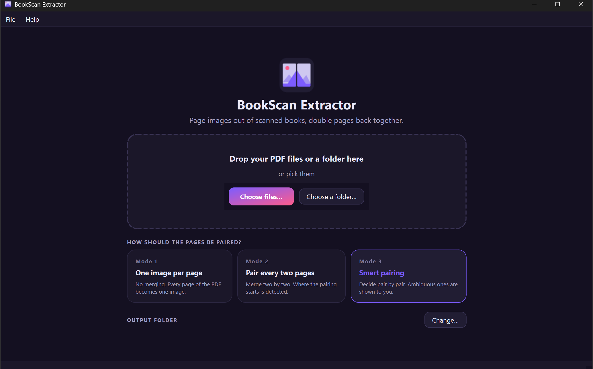

# 📖 BookScan Extractor

Desktop application (Windows 11) that extracts page images from scanned book PDFs and
re-joins the double-page spreads.



Three extraction modes:

| Mode | Name | Behaviour |
|---|---|---|
| 1 | Single | One output image per PDF page, no merging. |
| 2 | Systematic pairing | Every page merged two by two, with the starting offset (fly-leaf, half-title…) detected automatically. |
| 3 | Smart | Spreads detected by a model fitted on real scanned books; only the genuinely ambiguous pairs go to a validation screen. |

The engine (`src/pdfextract/core/`) never imports PySide6 and is fully usable from
the command line. The interface only drives it and reports its progress.

## Installation

```powershell
powershell -ExecutionPolicy Bypass -File install.ps1
```

Installs `uv` if needed (it brings its own Python), creates the virtual environment
and puts a shortcut in the Start Menu.

The shortcut runs `pythonw -m pdfextract` through `.venv\Scripts\pdfextract-launcher.exe`,
a copy of the windowed launcher shipped with Python (`venvwlauncher.exe`), so no
console window ever opens. Neither `run.cmd` nor the `pythonw.exe` of the virtual
environment can be used for this: a `.cmd` file brings its own `cmd.exe` window
along, and the `pythonw.exe` of a uv virtual environment is a trampoline compiled as
a console program, so it allocates a console whatever its name suggests.

## Using it

Adding files, or a folder, lists them in the queue with a tick box already ticked.
Nothing is processed until **Start**, which only takes the ticked files; the others
stay in the list for later, or can be removed from it. The mode can be set globally
or overridden file by file, and a right click offers to run a file again, optionally
imposing where the mode 2 pairing starts.

While a batch runs, the whole window shows its progress: a ring with the percentage, the file and the page being worked on, the time left, the state of each file, and buttons to check the pairs already waiting, pause or cancel.

The validation screen closes by itself once the last pair is decided. When every
file is processed and decided, the window returns to its start screen with the
outcome on top (files done, images written, double pages joined, pages left out),
a button to open the images, the file list one click away, and the drop zone ready
for the next book or folder.

Update with `update.cmd`, or from *Help > Check for updates* inside the application.
Both do a `git pull` followed by a dependency sync: there is no frozen executable to
rebuild.

## Command line

```bash
uv run pdfextract extract --mode 3 --out out book.pdf
uv run pdfextract extract --mode 2 --recursive --out out scans/
uv run pdfextract calibrate book.pdf          # distribution of the spread evidence
uv run pdfextract info book.pdf
uv run pdfextract settings --init
```

`extract` runs the same state machine as the interface: ambiguous pairs land in the
validation queue instead of blocking their file. `--auto-review engine|merge|split`
decides them without a user, for scripted batches.

## How spreads are detected

Measured on four real photo books (430 adjacent pairs, 33 spreads), the smart mode
merges about half of the spreads on its own, asks about almost all the others and
has merged no pair that was not a spread. The previous, hand-weighted score merged
none on its own, missed a third of them silently and merged four wrong pairs.

1. **Impossible pairs are ruled out first** (`core/spread.py`): a blank page, a
   picture that stops on a light margin with a straight edge along the gutter (a
   framed print, a text block), or a strip of light paper along the gutter. About
   seven pairs in ten go this way, with no question asked.
2. **The rest get an evidence**, the log-odds of a small logistic model over gutter
   features: whether rows, texture, tone and colour carry on across the gutter.
3. **The parity of the book** corrects it: spreads keep the same facing pages
   through a book, so once a few likely spreads agree on a parity, pairs on that
   parity gain evidence and pairs on the other lose a lot of it.
4. **One arrangement for the whole book** is chosen by a dynamic programme, so no
   page ends up in two pairs. Pairs at or above `merge_evidence` (4) are merged
   without a question, which also settles their pages: no question is asked about a
   pair that would reuse one of them. Between `split_evidence` (-1) and that, the
   user decides.

All of these values live in *Settings > Continuity* and *Settings > Pairing*. To see
where a book stands, and to grade the mode on books of your own:

```bash
uv run pdfextract calibrate "a real book.pdf" --list-uncertain
uv run python tools/score_report.py "a real book.pdf" --plate report.jpg
uv run python tools/evaluate.py my-labels.json --books "D:/books"
```

`evaluate.py` takes a JSON file of hand-made labels (kept out of the repository)
and prints, book by book, the spreads merged, asked about and missed, the wrong
merges and the number of questions.

## How the engine works

- **Extraction** keeps the original compressed stream untouched whenever the page
  holds a single full-page image and nothing has to be transformed: no re-encoding,
  no loss, nearly instantaneous. A rotated or mirrored page is decoded and
  reoriented at its source resolution rather than re-rendered at a fixed dpi.
  Anything else falls back to rendering.
- **Scoring** (`core/seam.py`, `core/spread.py`) compares the inner edges of two
  consecutive pages, ignoring the gutter strip itself, searches the vertical offset
  that lines them up, rules out impossible pairs and turns the rest into an
  evidence (see above).
- **Pairing** (`core/pairing.py`) applies the parity of the book and a dynamic
  programme over the sequence of pages, so no page can end up in two pairs.
- **Naming** is based on the source page number, never on the order files reach the
  disk, because safe pages are written immediately and ambiguous ones only after the
  user has decided. Sorting the output folder always gives the order of the book.
- **Validation never blocks processing**: a file that needs the user exports
  everything it can, hands its ambiguous pairs over and releases its worker.
- **Sources go to the recycle bin only**, through `send2trash`, once every guard has
  passed, and every move is written to the application log.

## Layout

```
src/pdfextract/
├── cli.py                 headless interface
├── core/                  the engine, no Qt anywhere
│   ├── document.py        opening, page inventory, integrity
│   ├── extractor.py       native stream extraction, fallback rendering
│   ├── seam.py            gutter comparison and vertical offset
│   ├── spread.py          spread vetoes and fitted model
│   ├── pairing.py         pairing decision, modes 2 and 3
│   ├── merger.py          merging two half-pages
│   ├── postprocess.py     deskew, crop, gutter shadow, contrast, resize
│   ├── naming.py          filename template engine
│   ├── sidecar.py         persistence of the user decisions
│   ├── settings.py        configuration and profiles
│   ├── trash.py           guarded move to the recycle bin
│   ├── review_queue.py    queue of batches awaiting validation
│   ├── job.py             job model and extraction plan
│   └── runner.py          the state machine and the worker pool
└── ui/                    PySide6
    ├── main_window.py     import, queue, settings
    ├── review_window.py   validation screen
    ├── preloader.py       high priority look ahead loader
    ├── queue_panel.py     the queue table
    ├── settings_dialog.py forms generated from the configuration dataclasses
    └── workers.py         engine callbacks to Qt signals
```

`runner.py` is not in the original specification: the job model has to stay
importable by `sidecar.py`, so the execution lives in its own module.

## Development

```bash
uv sync
uv run pytest
uv run ruff check .
uv run mypy
uv run python tools/make_fixtures.py     # sample PDF files under tests/fixtures/generated
```

Code, names and comments are in English; the engine follows PEP 8 with type hints
throughout.

`send2trash` is replaced by a recorder for the whole test suite, so a regression in
the guards fails a test rather than moving one of your files.

## Support

If BookScan Extractor saved your book-digitizing project some pain:

[](https://ko-fi.com/hypedigger)

## License

[AGPL-3.0](LICENSE). The engine is built on PyMuPDF, which is itself AGPL v3; this
project therefore carries the same license. If you need a permissively licensed
alternative, the rendering could be ported to `pypdfium2` (BSD/Apache), which is
less convenient for pulling raw streams out but perfectly viable for rendering.
